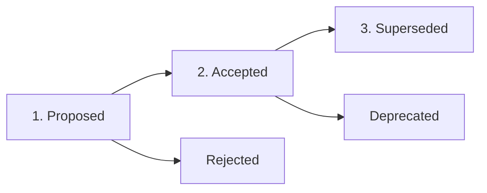

# Architecture Decision Records (ADR) Lifecycle and Template

Authoritative specification for creating, managing, and deprecating Architecture Decision Records.

---

## 1. What is an ADR?

An Architecture Decision Record (ADR) captures an important architectural or technical choice made on a project along with its context and consequences.

Key attributes of effective ADRs:
- **Immutable historical record**: Once accepted, an ADR is not revised to say something different. If the decision changes, a new ADR supersedes it.
- **Context-focused**: Explains *why* options were selected and what trade-offs were accepted.
- **English-only**: Standardized in English across all engineering teams.

---

## 2. ADR Lifecycle States



1. **Proposed**: Under RFC or active peer discussion. Implementation has not started.
2. **Accepted**: Approved by technical leads/team. Implementation adheres to this decision.
3. **Rejected**: Decision evaluated and abandoned. Preserved to prevent re-hashing settled debates.
4. **Superseded**: Replaced by a newer ADR (e.g., "Superseded by ADR-0012").
5. **Deprecated**: The feature or architectural pattern has been retired completely.

---

## 3. Storage Formats

Projects may choose either a **Unified Log** (ideal for smaller or harness-managed repos) or **Modular Files** (ideal for enterprise systems).

### Option A: Unified Log (`decisions.md`)
Maintained under `.grooveskills/memory/decisions.md` or `docs/decisions.md`:

```markdown
# Architecture Decision Records (ADR)

| Date | Title | Decision | Reason & Consequences |
| :--- | :--- | :--- | :--- |
| 2026-11-01 | Adopt Harness | Initialized `.grooveskills/` | Standardized agent memory and 3-lane execution |
| 2026-11-03 | Fail-Fast Env Validation | Adopted Valibot at boot time | Catches missing env vars before startup; slight schema build overhead |
```

### Option B: Modular Numbered Records (`docs/architecture/adr/XXXX-title.md`)
Numbered sequentially with zero-padded prefixes:
- `0001-use-hono-over-express.md`
- `0002-cache-aside-with-redis.md`

---

## 4. Canonical ADR Template (Markdown)

Use the following template when authoring dedicated ADR files:

```markdown
# ADR-0004: Decouple External Providers via Pure Domain Ports

- **Status**: Accepted
- **Date**: 2026-11-03
- **Deciders**: Engineering Team
- **Consulted**: Tech Leads, Security Team
- **Supersedes**: ADR-0001 (Direct Vendor SDK Calls)

## Context and Problem Statement
Our application previously instantiated third-party SDKs (Stripe, Resend) directly inside HTTP controllers and actions. This created tight coupling, prevented automated unit testing with in-memory fakes, and made switching cloud providers painful.

## Decision Drivers
- Need for deterministic unit testing without network mocks or live API keys.
- Need to isolate credential management into dedicated infrastructure wrappers.
- Need to support swapping email providers (Resend -> AWS SES) with zero changes to business logic.

## Considered Options
1. **Direct SDK usage** (Status quo) - Minimal initial boilerplate, but fragile and untestable.
2. **Repository pattern for all APIs** - Misleading abstraction for non-database operations.
3. **Domain Ports & Swappable Adapters** (Chosen) - Actions depend on pure interfaces.

## Decision Outcome
Chosen Option: **Domain Ports & Swappable Adapters**. We define pure domain interfaces (e.g. `PaymentGatewayPort`) under `src/types/<domain>/` and concrete implementations under `src/infrastructure/adapters/`.

### Positive Consequences
- Business actions remain 100% pure and independent of vendor libraries.
- Unit tests use fast `MemoryPaymentGatewayAdapter` executing in milliseconds.
- Provider changes require writing only one new adapter file.

### Negative Consequences / Trade-offs
- Requires writing an explicit port interface and DTO mapping per external provider.
- Increases the number of files by one port and one wrapper per integration.

## Links & References
- Relative spec link: [Architecture Overview](../system-design.md)
- Domain Ports Guide: [External Service Adapters Guide](../../guides/adapters.md)
```

---

## 5. Review & Authoring Checklist

Before submitting an ADR:
- [ ] Is it written in clear, concise English?
- [ ] Does it reference relevant documents using relative POSIX paths?
- [ ] Are trade-offs (negative consequences) explicitly stated, not hidden?
- [ ] Is the status clearly marked?
- [ ] Does the file stay well under the 200-line limit?
