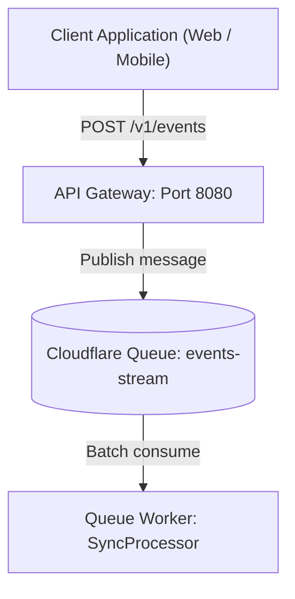
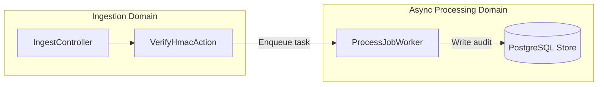
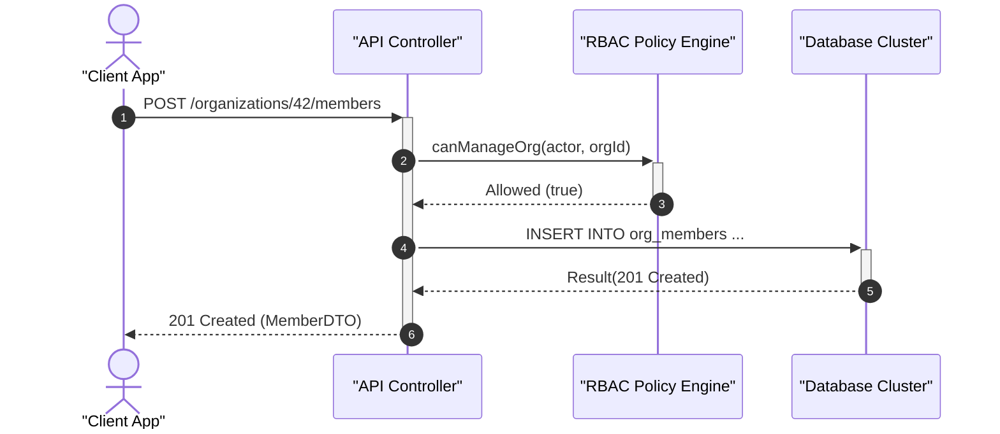

# Relative Paths and Mermaid Diagrams Standard

Reference guide for constructing portable markdown links and bulletproof Mermaid diagrams.

---

## 1. Relative POSIX Links

Documentation must remain navigable across GitHub/GitLab web view, local IDEs, CLI tools, and static site generators without relying on machine-specific absolute paths.

### 1.1 Strict Rules

1. **Always Relative**:
   - ✅ Correct: `[Architecture Overview](../architecture/overview.md)`
   - ❌ Wrong: `[Architecture Overview](/Users/alice/projects/app/docs/architecture/overview.md)`
   - ❌ Wrong: `[Architecture Overview](file:///C:/projects/app/docs/architecture/overview.md)`
2. **POSIX Forward Slashes Only**:
   - Always use `/` even in Windows environments (`./guides/setup.md`, never `.\guides\setup.md`).
3. **Explicit Dot Notation**:
   - Siblings or subfolders: prefix with `./` (e.g., `./references/diagrams.md`).
   - Parents: prefix with `../` (e.g., `../../README.md`).
4. **Anchor Links**:
   - Match GitHub header slug generation: lowercase, hyphen-separated, strip special symbols.
   - Example: `[Jump to Section](#3-mermaid-syntax-safety)`.

### 1.2 Path Resolution Reference

Given this file layout:
```text
repo/
├── README.md
├── docs/
│   ├── overview.md
│   └── architecture/
│       ├── system-design.md
│       └── adr/
│           └── 0001-queue.md
└── src/
    └── index.ts
```

| Source File | Destination File | Correct Markdown Link |
| :--- | :--- | :--- |
| `README.md` | `docs/overview.md` | `[Overview](./docs/overview.md)` |
| `docs/overview.md` | `docs/architecture/system-design.md` | `[System Design](./architecture/system-design.md)` |
| `docs/architecture/adr/0001-queue.md` | `docs/architecture/system-design.md` | `[System Design](../system-design.md)` |
| `docs/architecture/adr/0001-queue.md` | `README.md` | `[Root README](../../../README.md)` |

---

## 2. Mermaid Diagram Construction

Mermaid diagrams render directly in GitHub and modern editors. Invalid syntax breaks the entire document view. Follow these guidelines to ensure resilient diagrams.

### 2.1 Direction and Layout
- Prefer `flowchart TD` (Top-to-Bottom) for hierarchical workflows or pipelines.
- Prefer `flowchart LR` (Left-to-Right) for message busses, data processing streams, or step sequences.

### 2.2 Node Names and Safe Quoting
Mermaid syntax uses special characters like `(`, `[`, `{`, `<`, `>`, `"`, and `:` for shape definitions. Placing these inside unquoted labels triggers parsing failures.

**The Golden Rule**: Always wrap the label string in double quotes `["..."]`.



### 2.3 Subgraphs with Safe Identifiers
Always give subgraphs explicit alphanumeric identifiers before their quoted titles:



### 2.4 Sequence Diagrams
For sequence flows, quote participants with descriptive names:



### 2.5 Common Pitfalls & Anti-Patterns
1. **Unquoted brackets inside shapes**:
   - ❌ Broken: `A[User [Admin]]`
   - ✅ Correct: `A["User [Admin]"]`
2. **Missing line breaks**:
   - Keep node declarations on separate lines for readability.
3. **Overly dense diagrams**:
   - If a diagram exceeds 20 nodes, break it down into modular sub-flowcharts across topic guides.
